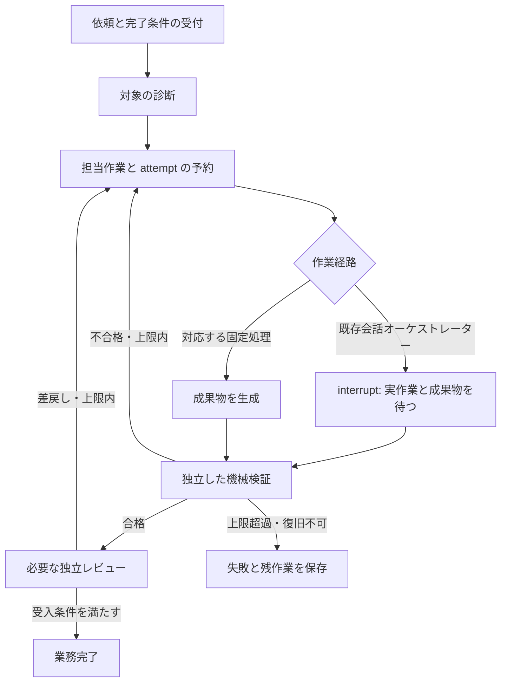

# LangGraph による業務・保守運用

外部フレームワーク（LangGraph）を業務管理の実装へ組み込む設計文書。

適用判断は運用側の方針文書（このリポジトリには含めない）に従う。実作業の依頼には既定で適用し、適用可否や構成選択に迷う場合は人間に確認する。明確な対象について使用許可を毎回取り直さない。

## 設計判断の経緯

以前の `ops_harness` は標準ライブラリ製の診断・手順案内で、外部フレームワークが仕事の進行（受付・検証・差戻し・完了）を管理していなかった。診断基盤としては有用だが、それだけでは業務の完了管理を満たさないため、本書の構成に改めた。

**採用構成は LangGraph + SQLite checkpointer + 既存 Codex / Claude オーケストレーター + 既存専門 CLI + 独立検証である。** 旧設計資料（非同梱）にある「LangGraph を見送る」「診断・手順案内だけを追加する」という記述より、本書と実装を優先する。

実インストール済みの依存は `langgraph==1.2.12` と `langgraph-checkpoint-sqlite==3.1.1`。専用環境 `.harness/venv` に導入し、他システムの Python 環境と分ける。

## フレームワークが担当する仕事



LangGraph が `StateGraph` の遷移と条件分岐を実行し、`SqliteSaver` が job ごとの checkpoint を永続化する。作業・レビューを待つ段階は `interrupt`、証跡の提出後は `Command(resume=...)` で再開する。親オーケストレーターは実作業を担当するが、単に「完了した」と宣言してグラフを完了にしない。

役割分担は次のとおり。

| 部品 | 実際の責務 |
|---|---|
| LangGraph | 作業受付、診断、担当作業の発行、結果待ち、検証、差戻し、レビュー、完了・失敗への遷移 |
| SQLite checkpointer | 同じ job を別 CLI プロセスから追跡・再開するための状態保存 |
| `ops_harness` probes | localhost API、タスク登録（設定ファイルで宣言したもの）、ファイル参照など、既存の読み取り診断 |
| Codex / Claude の親 | 必要な専門担当への委譲、既存 CLI 実行、修正・制作、成果物の提出 |
| 機械 verifier | 成果物の実在・内容・指定条件・ハッシュ等を作業者の自己申告とは別に確認 |
| 独立 reviewer | 機械判定だけでは確定できない依頼との整合、意味内容、受入条件を確認 |
| 既存公開・課金ゲート | 投稿や生成などの副作用を、今回までの許可範囲に従って制御 |

checkpoint は外部 API の二重実行を自動で防ぐ機構ではない。公式仕様では、interrupt のある node は再開時に先頭から実行される。再実行できない操作を interrupt より前に置かず、不明な公開・課金結果を自動再送しない。

## 接続する業務

`daily-ops`、`incident`、`video-production`、`content-production`、`business-support`、`distribution-maintenance` は、グラフから会話親へ担当作業を発行する。親はその依頼を実施し、成果物を提出する。グラフが検証し、別のレビュー段階を経て完了または差戻しを決める。これらは常駐エージェントが無人で全工程を実行するという意味ではない。

追加の実行経路:

- **`software-development`**: `dev-acceptance-harness` リポジトリの `docs/DEV_HARNESS.md` の実OpenSpecを接続する。`openspec`成果物のchange/profileを固定し、公式検証・task完了・固定テスト・提出時のコード/仕様ハッシュを確認する。別レビュー後も同じ検証を再実行する。一般的な成功JSONだけでは代用できない。

- **`daily-report`**: グラフ内で診断報告書を生成し、診断証跡との内容一致を検証する。完了するのは「日次診断報告書の作成」であり、異常サービスの修復ではない。報告書に `fail` や `unknown` があっても隠さない。
- **`memory-maintenance`**: 既存 `scripts/qa_memory_md_lint.py` を固定 CLI として接続し、非空・既存リンク保持などの条件と組み合わせる。lint は空ファイルでも終了コード0になり得るため、単独で保守完了を認定しない。意味内容は独立レビューで確認する。

汎用のファイル存在・ハッシュ確認だけで、動画品質、営業資料の正確性、投稿成功を証明したことにはならない。対象業務の追加 QA や受入レビューが必要である。依頼と関係のないファイルを提出して complete にしない。

## 設計判断の経緯（採用までの検討）

- 診断層だけでは仕事の完了までを管理できないため、LangGraph の graph / checkpoint / interrupt で作業提出・検証・差戻しまで管理する案を採った。
- 「done JSON を submit すれば complete」では不足するので、グラフ側の独立検証と workflow ごとの受入条件を置く。daily-report の完了を障害修復へ拡大しない。
- dispatch と interrupt を分離し、attempt を永続化してから待機する。上限・古い提出・同時実行を制御する。
- 既存 CLI の接続例として、課金なしのメモリ lint と日次報告書作成を実装した。lint は内容削除を検出できないため、リンクや非空の保持条件を組み合わせる。
- 受入の重点は、再開できることに加え、失敗→作業提出→再検証→レビュー→完了を通すこと。未完了や未知を成功扱いせず、設定変更・古い提出・同時操作を誤受入しない。

## なぜこの組み合わせか

**LangGraph を導入する。** このプロジェクトでは既存 CLI と会話側の専門担当が充実している一方、依頼をまたぐ状態・再開・受入条件が分散している。低レベルの graph 制御で既存資産を接続し、仕事の状態を永続化する用途に合う。

**Deep Agents は今回の必須依存にしない。** LangGraph の上に LLM 実行ループ、ファイル操作、サブエージェントなどをまとめた層であり、現在の Codex / Claude 親と重なる。常駐の自律作業者が必要になったら、dispatch の作業 adapter として比較する。LangGraph の代わりに名前だけ追加することはしない。

**Inspect AI / Harbor は回帰検証の置き換えにしない。** 今回は既存 pytest と実 CLI で状態遷移・成果物・再開を確認する。今後 LLM の判断品質・コスト・タスク達成率を比較する評価セットが必要になった段階で追加する。

根拠となる公式資料:

- [LangGraph の API と SQLite checkpoint](https://reference.langchain.com/python/langgraph/overview)
- [interrupt と再開時の node 再実行](https://docs.langchain.com/oss/python/langgraph/interrupts)
- [LangGraph / LangChain / Deep Agents の関係](https://www.langchain.com/blog/deep-agents-vs-langchain-vs-langgraph)

## オーケストレーターへの指示例

通常はユーザーが JSON や CLI を毎回手作業で組み立てる必要はない。次のように依頼し、親に job 作成から受入まで進めさせる。

### 日次の報告書

> LangGraph の daily-report job として、今日の日次診断報告書を作成してください。実測した正常・異常・未検証を区別し、報告書の内容と診断証跡が一致することまで検証してください。報告書作成の完了と障害復旧の完了を分け、成果物は閲覧できる URL で渡してください。

### 障害調査と修正

> LangGraph の incident job で、〔対象〕の〔症状〕を修正してください。完了条件は〔利用者が確認できる正常状態〕です。既存の許可範囲で調査・修正・独立検証まで進め、成果物と証跡を submit してください。別担当による受入レビューを通し、グラフの完了状態を確認してください。診断だけで終了しないでください。

### メモリの保守

> LangGraph の memory-maintenance job で、〔対象 Markdown〕を保守してください。情報とリンクを保持して読みやすく整理し、既存 lint と保存条件で検証してください。自己申告で完了にせず、独立レビューまで実施してください。

### 制作と納品

> LangGraph の〔video-production / content-production / business-support / distribution-maintenance〕job で、〔成果物〕を完成してください。完了条件は〔条件〕、費用・公開・送信の許可範囲は〔対象と上限〕です。既存専門 CLI と QA を使い、成果物の検証と独立レビューを通し、URL から取得できることを確認して渡してください。

### 中断した仕事の継続

> job〔ID〕の保存状態と未完了工程を確認し、同じ job を続行してください。すでに成功した公開・課金を再実行せず、待機中の作業またはレビューに必要な証跡を揃えて完了まで進めてください。

## CLI の入口

通常の入口は `python scripts/ops/harness.py job list`。初期セットアップ・再構築は `python scripts/ops/harness.py --setup` で固定依存を導入する。Windows の PowerShell 実行ポリシーを変更せずに使えるよう、Python 入口を用意している。

プロジェクトルートから専用 Python を使う。以下の `request.json` 等は当該 job の契約に沿って作成するファイル名であり、同名ファイルが同梱されているという意味ではない。

```powershell
.\.harness\venv\Scripts\python.exe -m ops_harness job start --job-id example-001 --request request.json
.\.harness\venv\Scripts\python.exe -m ops_harness job status example-001
.\.harness\venv\Scripts\python.exe -m ops_harness job submit example-001 --submission submission.json
.\.harness\venv\Scripts\python.exe -m ops_harness job review example-001 --review review.json
.\.harness\venv\Scripts\python.exe -m ops_harness job continue example-001
.\.harness\venv\Scripts\python.exe -m ops_harness job cancel example-001
```

`start` は workflow のコードと共通の検証部分を job ごとの読み取り専用の写し（verifier pin）に固定し、以降のコマンドはその写しで実行される。workflow のコードや登録台帳を更新しても進行中の job は止まらない。software-development の提出用 gate JSON は `job gate <job-id>` で作り、pin は `job pin <job-id>` で確認する（詳細は `dev-acceptance-harness` リポジトリの `docs/DEV_HARNESS.md`「検証プログラムの固定」）。

作業者は `status` の待機契約を読み、現在の attempt に対する成果物だけを提出する。`continue` は待機契約を飛び越すコマンドではない。具体的な入力スキーマと受入規則は実装・配布されたサンプル・CLI help を確認する。

要求の成果物契約は、少なくとも目的、workflow、受入条件、検証対象を持つ。例として資料ファイルを提出する要求は次の構造になる。

```json
{
  "objective": "指定された仕様の資料を完成させる",
  "workflow": "business-support",
  "criteria": [
    {"id": "c1", "description": "依頼の目的・前提・実行手順を満たす資料である"}
  ],
  "artifacts": [
    {
      "path": "deliverables/example-plan.md",
      "kind": "file",
      "min_bytes": 1,
      "contains": ["目的", "前提", "実行手順"],
      "reuse": false
    }
  ]
}
```

この例の文字列検査は資料の意味品質の代わりにならない。受入条件 `c1` は独立レビューでも確認する。成果物の `path` は workspace 内の相対パス、区切りは `/`。`file` は `contains`、`json` はトップレベルの期待値 `json_equals`、`memory` は既存 Markdown のリンク保持と lint を使う。初期のハッシュとリンクは job 開始時に固定し、再開時に都合よく取り直さない。

提出する成果物は要求した集合と一致させ、実ファイルから計算した `sha256` を指定する。`daily-report` は専用生成・検証経路のため、親が管理する定型の契約を使用する。review の入力では、現在の待機契約・対象 attempt・受入条件に対応した独立確認結果を指定する。

## 運用上の境界

- 依頼で許可済みの調査・修正・検証を繰り返し確認しない。interrupt は親への作業依頼や別 reviewer 待ちにも使い、毎回ユーザー承認を求めるための仕組みにしない。
- 未許可の送信・公開・課金は、対象と費用等を具体化してから確認する。job の存在自体はその許可ではない。
- generic verifier が保証するのは実装された検査の範囲だけ。内容品質や本番での実成果が必要なら、対応する独立 QA・レビュー証跡を揃える。
- reviewer_id は運用上の担当名であり、本人認証ではない。親は実際に別担当へレビューを委譲する。名前だけ変えた自己レビューは不可。
- API の返答や秘密情報を生のまま公開用レポートへ保存しない。checkpoint と作業台帳はローカル内部情報として扱う。
- 自動起動・定期実行・通知は別の依頼がない限り開始しない。CLI が中断している仕事を「裏で継続実行中」と表現しない。
- 実証結果は実行ログと親の統合報告で確認する。本書だけをテスト成功・本番修復・全業務対応の証明に使わない。
